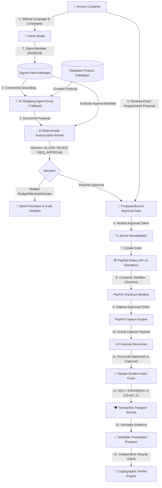

# INTENTLEDGER AI — SYSTEM ARCHITECTURE SPECIFICATION

**Tagline:** Every AI transaction deserves proof.  
**Version:** 1.0.0 (Production Blueprint)  
**Classification:** Financial Infrastructure & Agentic Commerce Accountability  

---

## 1. Executive Architecture Summary

INTENTLEDGER AI bridges the critical trust and accountability gap between autonomous AI agents and financial payment systems. While generative models are increasingly capable of finding products and recommending purchases, **an LLM must never possess financial authorization authority**.

INTENTLEDGER enforces an independent, deterministic policy and verification layer between:
1. **Human Purchase Intent** (Structured Intent Mandates with cryptographic signatures).
2. **AI Shopping Agent** (Product discovery and structured purchase proposals).
3. **Deterministic Authorization Kernel** (Backend rule engine executing 18 independent policy checks).
4. **Exact Human Approval** (Cryptographically proposal-bound single-use authorization token).
5. **PayPal Payment Orchestrator** (Orders API v2 OAuth, order creation, capture, and reconciliation).
6. **Cryptographic Transaction Passport** (Hash-linked event ledger verifying complete transactional integrity).

---

## 2. Core Architectural Subsystems

### 2.1 Intent Studio & Mandate Engine
- **Responsibility:** Captures natural-language instructions and transforms them into strictly typed, immutable structured constraints.
- **Constraints Schema:** `budgetLimit`, `currency`, `permittedMerchants`, `restrictedMerchants`, `requiredAttributes`, `excludedCategories`, `maxQuantity`, `expiryTimestamp`, `requireHumanApproval`.
- **Cryptographic Binding:** Each mandate is serialized canonically and signed using the platform's Ed25519 signing keypair with an assigned `keyVersion` and tamper-evident fingerprint.

### 2.2 Curated Database-Backed Product Catalogue
- **Responsibility:** Serves as the ground truth for product pricing, availability, and merchant identities.
- **Security Rule:** The AI agent and payment systems never accept client-provided prices or hallucinated product metadata. All values resolve strictly from the internal catalogue.

### 2.3 Deterministic Authorization Kernel
- **Responsibility:** An isolated backend service executing 18 deterministic checks.
- **Key Reason Codes:**
  - `MANDATE_NOT_FOUND`, `MANDATE_INACTIVE`, `MANDATE_EXPIRED`, `MANDATE_REVOKED`
  - `BUDGET_EXCEEDED`, `MERCHANT_NOT_ALLOWED`, `MERCHANT_RESTRICTED`
  - `PRODUCT_CONSTRAINT_VIOLATION`, `QUANTITY_EXCEEDED`, `CURRENCY_MISMATCH`
  - `APPROVAL_REQUIRED`, `APPROVAL_EXPIRED`, `APPROVAL_ALREADY_USED`, `PROPOSAL_FINGERPRINT_MISMATCH`
- **Zero-LLM Authority:** The model outputs a recommendation; the kernel alone decides `ALLOW`, `BLOCK`, or `REQUIRE_APPROVAL`.

### 2.4 Proposal-Bound Human Approval System
- **Responsibility:** Generates an approval token cryptographically tied to the SHA-256 fingerprint of the proposal (`productId`, `merchantId`, `amount`, `currency`, `quantity`, `mandateId`).
- **Tamper Invalidation:** Any mutation to the cart or proposed price invalidates the fingerprint, requiring explicit customer re-approval. Single-use enforcement prevents replay attacks.

### 2.5 PayPal Payment Orchestrator
- **Responsibility:** Interacts with PayPal Developer Sandbox via REST API v2 (`/v1/oauth2/token`, `/v2/checkout/orders`, `/v2/checkout/orders/{id}/capture`).
- **Payee Binding:** Maps catalogue merchants to configured PayPal Sandbox recipient accounts.
- **Pre-Capture Guard:** Server re-evaluates the mandate and approval validity immediately prior to issuing order creation and capture requests.
- **Reconciliation Engine:** Compares approved amount, created order amount, and captured funds. Any variance triggers a `RECONCILIATION_EXCEPTION`.

### 2.6 Cryptographic Transaction Passport & Tamper-Evident Ledger
- **Responsibility:** Constructs a cryptographically verified hash chain:
  $$H_n = \text{SHA256}(H_{n-1} \parallel \text{CanonicalJSON}(\text{Event}_n))$$
- **Event Timeline:** Mandate Creation $\rightarrow$ Proposal Generated $\rightarrow$ Authorization Evaluation $\rightarrow$ Human Approval $\rightarrow$ PayPal Order Created $\rightarrow$ PayPal Capture Completed $\rightarrow$ Financial Reconciliation $\rightarrow$ Passport Issued.
- **Verification Engine:** Verifies the cryptographic chain and detects modified payloads, missing events, or broken links.

### 2.7 AG Grid Operational Workspace & AG Studio
- **Responsibility:** High-density enterprise grid displaying transaction statuses, policy decisions, drift alerts, and reconciliation results.
- **AG Studio Integration:** Feasibility-evaluated reporting workspace with developer validations and grounded domain-specific AI analysis tools.

---

## 3. Technology Stack Matrix

| Layer | Technology | Justification |
| :--- | :--- | :--- |
| **Framework** | Next.js 15+ (App Router) | Server-side financial routes, API handlers, static/dynamic rendering |
| **Language** | TypeScript (Strict Mode) | End-to-end type safety, prevention of financial rounding bugs |
| **UI & Styling** | Tailwind CSS + shadcn/ui tokens | Enterprise fintech design system (Deep Navy, Slate, zero neon) |
| **Icons** | Lucide React | Clean, restrained geometric iconography |
| **Data Grid** | AG Grid Community 36.x | Enterprise transactional table with sorting, filtering, quick search |
| **Studio Analytics**| AG Studio 3.x | Sponsor reporting environment & data source integration |
| **Database** | PostgreSQL / Neon via Prisma ORM | ACID transactions, decimal currencies, relational integrity |
| **Payment** | PayPal REST API v2 Sandbox | Official Orders API, OAuth caching, Webhook signature verification |
| **AI Engine** | Groq Cloud API + Fallback Parser | High-speed structured LLM recommendation with deterministic fallback |
| **Cryptography** | Node.js `crypto` (SHA-256, Ed25519) | Canonical JSON serialization, tamper-evident hash chaining |
| **Testing** | Vitest + TypeScript Compiler | Unit, integration, and security scenario test suites |

---

## 4. Key Financial Boundaries & Principles
1. **Server-Side Sole Source of Truth:** The client browser is a presentation layer. Payment status and policy decisions are never set by frontend callbacks.
2. **No Secret Ingestion in Client Bundles:** All PayPal and AI credentials reside strictly in server environments.
3. **Idempotency by Design:** All payment creation and capture endpoints use unique idempotency keys to prevent double-charging.
4. **Honest Provenance:** Clear visual and structural distinction between Live Sandbox responses and isolated test fixtures.

